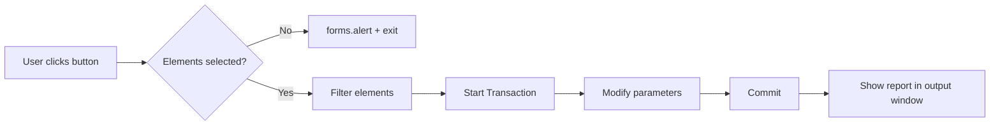

<!--
░█▀▄░█▀▀░█▀█░█▀▄░█▄█░█▀▀░░░▀█▀░█▀▀░█▄█░█▀█░█░░░█▀█░▀█▀░█▀▀
░█▀▄░█▀▀░█▀█░█░█░█░█░█▀▀░░░░█░░█▀▀░█░█░█▀▀░█░░░█▀█░░█░░█▀▀
░▀░▀░▀▀▀░▀░▀░▀▀░░▀░▀░▀▀▀░░░░▀░░▀▀▀░▀░▀░▀░░░▀▀▀░▀░▀░░▀░░▀▀▀
  pyRevit Extension README template.
  1. Find + replace every {{PLACEHOLDER}}.
  2. Delete sections you don't need.
  3. HTML comments like this one are invisible on GitHub - delete or keep as notes.
-->

<!-- ░█░█░█▀▀░█▀█░█▀▄░█▀▀░█▀▄ ─ centered logo + title + badges -->
<div align="center">

<!-- Light/Dark logo swap. Use one  if you have only one logo. -->
<picture>
  <source media="(prefers-color-scheme: dark)"  srcset="docs/img/logo_dark.png">
  <source media="(prefers-color-scheme: light)" srcset="docs/img/logo_light.png">
  
</picture>

# {{EXTENSION_NAME}}

**{{ONE_LINE_PITCH — e.g. "Batch-rename views and sheets in one click."}}**

[](https://github.com/pyrevitlabs/pyRevit)
[](https://www.autodesk.com/products/revit)
[](https://pyrevitlabs.notion.site/)
[](LICENSE)
[](https://github.com/{{GITHUB_USER}}/{{REPO_NAME}}/releases)

[Install](#-installation) · [Tools](#-tools) · [Tutorial](#-tutorial) · [Report Bug](https://github.com/{{GITHUB_USER}}/{{REPO_NAME}}/issues)


</div>

---

<!-- ░▀█▀░█▀█░█▀▀ ─ manual TOC. GitHub also auto-builds one (☰ icon top-right of README). -->
## 📑 Table of Contents

- [About](#-about)
- [Requirements](#-requirements)
- [Installation](#-installation)
- [Folder Structure](#-folder-structure)
- [Tools](#-tools)
- [Tutorial](#-tutorial)
- [Script Anatomy](#-script-anatomy)
- [How It Works](#️-how-it-works)
- [Roadmap](#-roadmap)
- [FAQ](#-faq)
- [Contributing](#-contributing)
- [Credits](#-credits)
- [License](#-license)

---

## 💡 About

{{SHORT_DESCRIPTION — 2-3 sentences. What problem? Who is it for? Why pyRevit?}}

> [!NOTE]
> This extension is part of the **{{TUTORIAL_NAME}}** tutorial.
> Follow along step by step at [{{TUTORIAL_URL}}]({{TUTORIAL_URL}}).

> [!TIP]
> New to pyRevit? Start with the [official pyRevit docs](https://pyrevitlabs.notion.site/) and [LearnRevitAPI](https://learnrevitapi.com).

> [!IMPORTANT]
> Tools modify the model. **Save / sync before running.** All changes are wrapped in a Transaction, so <kbd>Ctrl</kbd> + <kbd>Z</kbd> undoes them.

> [!WARNING]
> {{KNOWN_LIMITATION — e.g. "Does not work on linked models."}}

> [!CAUTION]
> {{DANGEROUS_ACTION — e.g. "Purge tool deletes elements permanently after sync."}}

---

## 🧰 Requirements

| Requirement | Version                     | Notes                                                       |
|:------------|:---------------------------:|------------------------------------------------------------:|
| Revit       | {{REVIT_MIN}}–{{REVIT_MAX}} | Tested on {{TESTED_VERSIONS}}                               |
| pyRevit     | {{PYREVIT_VERSION}}+        | [Download](https://github.com/pyrevitlabs/pyRevit/releases) |
| OS          | Windows 10 / 11             | Revit is Windows-only                                       |
| Engine      | IronPython 2.7 / CPython 3  | Set via `#! python3` shebang                                |

---

## 📦 Installation

### Option A — pyRevit Extension Manager (easiest)

1. Revit ribbon → **pyRevit** tab → **Extensions**.
2. Search `{{EXTENSION_NAME}}` → **Install Extension**.
3. Click **Reload** (pyRevit tab).

### Option B — pyRevit CLI

```bash
pyrevit extend ui {{EXTENSION_NAME}} https://github.com/{{GITHUB_USER}}/{{REPO_NAME}}.git --dest="C:\pyRevit\Extensions"
```

### Option C — Manual (local folder)

1. Download ZIP / `git clone` into a folder, e.g. `C:\pyRevit\Extensions\`.
2. pyRevit tab → **Settings** → **Custom Extension Directories** → add that folder.
3. **Save Settings and Reload**.

<details>
<summary><b>🔧 Installation not working? Click to expand</b></summary>

<br>

- Folder name **must** end with `.extension` → `{{EXTENSION_NAME}}.extension`.
- Point pyRevit to the **parent** folder, not the `.extension` folder itself.
- Read the pyRevit output window after **Reload** for load errors.
- Still stuck? Ask on [pyRevit Forum](https://discourse.pyrevitlabs.io/).

</details>

---

## 🗂 Folder Structure

```text
{{EXTENSION_NAME}}.extension/
├── extension.json                     # metadata for Extension Manager
├── lib/                               # shared code → importable from any button
│   └── {{LIB_NAME}}/
│       └── __init__.py
└── {{TAB_NAME}}.tab/                  # ribbon TAB
    ├── {{PANEL_1}}.panel/             # ribbon PANEL
    │   ├── {{BUTTON_1}}.pushbutton/   # single button
    │   │   ├── script.py
    │   │   ├── icon.png               # button icon (icon.dark.png for dark theme)
    │   │   └── bundle.yaml            # optional: title, tooltip, author...
    │   ├── {{PULLDOWN}}.pulldown/     # dropdown with many buttons
    │   │   ├── ToolA.pushbutton/
    │   │   └── ToolB.pushbutton/
    │   └── {{STACK}}.stack/           # 2-3 small buttons stacked vertically
    │       ├── Small1.pushbutton/
    │       └── Small2.pushbutton/
    └── {{PANEL_2}}.panel/
        ├── {{SPLIT}}.splitbutton/     # remembers last used child
        ├── {{TOGGLE}}.smartbutton/    # on/off toggle (__selfinit__)
        └── {{DOCS}}.urlbutton/        # opens a web link
```

| Bundle type          | Looks like            | Use for                          |
|:---------------------|:----------------------|:---------------------------------|
| `.pushbutton`        | Large / small button  | One tool = one script            |
| `.pulldown`          | Button + ▼ menu       | Group of related tools           |
| `.splitbutton`       | Button + ▼, remembers | Variants of one tool             |
| `.splitpushbutton`   | Like split, fixed top | Main tool + alternatives         |
| `.stack`             | 2–3 small buttons     | Save ribbon space                |
| `.smartbutton`       | Toggle button         | On/off states, startup logic     |
| `.urlbutton`         | Link button           | Docs, tutorial, support page     |
| `.linkbutton`        | Button → C# / DLL     | Compiled add-in commands         |

---

## 🛠 Tools

<!-- One row per button. Icons: relative path to each button's icon.png. -->
| Icon | Tool | Description | Modifier |
|:----:|:-----|:------------|:--------:|
|  | **{{BUTTON_1}}** | {{WHAT_IT_DOES}} | <kbd>Shift</kbd>+Click → `config.py` |
|  | **{{BUTTON_2}}** | {{WHAT_IT_DOES}} | — |
|  | **{{BUTTON_3}}** | {{WHAT_IT_DOES}} | <kbd>Alt</kbd>+Click → open script folder |

### {{BUTTON_1}} — Demo

<!-- GIF/MP4 demo. Drag & drop an .mp4 into GitHub editor → auto-uploads + embeds player. -->
<p align="center">
  
</p>

**Before → After**

<table>
  <tr>
    <th>Before</th>
    <th>After</th>
  </tr>
  <tr>
    <td></td>
    <td></td>
  </tr>
</table>

---

## 🎓 Tutorial

<!-- Task list = progress tracker for students. Checkboxes render on GitHub. -->
### Lesson Checklist

- [x] **Lesson 01** — Create `.extension` folder + first button
- [x] **Lesson 02** — Get selected elements (`uidoc.Selection`)
- [ ] **Lesson 03** — Filter elements with `FilteredElementCollector`
- [ ] **Lesson 04** — Modify parameters inside a `Transaction`
- [ ] **Lesson 05** — Build UI with `pyrevit.forms`
- [ ] **Lesson 06** — Share extension on GitHub

### Step 1 — Create your first button

Create this path:

```text
{{EXTENSION_NAME}}.extension\{{TAB_NAME}}.tab\{{PANEL_1}}.panel\Hello.pushbutton\script.py
```

Paste into `script.py`:

```python
# -*- coding: utf-8 -*-
__title__ = "Hello\nWorld"
__doc__   = "My first pyRevit button."

from pyrevit import forms

forms.alert("Hello from {{EXTENSION_NAME}}!", title="{{EXTENSION_NAME}}")
```

Click **Reload** in pyRevit tab → new button appears. 🎉

### Step 2 — Change existing code

<!-- diff block = show what changed between lessons -->
```diff
  from pyrevit import forms
+ from pyrevit import revit

- forms.alert("Hello from {{EXTENSION_NAME}}!")
+ sel = revit.get_selection()
+ forms.alert("You selected {} elements.".format(len(sel)))
```

### Step 3 — {{NEXT_STEP_TITLE}}

{{NEXT_STEP_CONTENT}}

---

## 🧬 Script Anatomy

```python
# -*- coding: utf-8 -*-
#! python3                                   # optional: run on CPython 3 engine (line 1)

# ╦╔╦╗╔═╗╔═╗╦═╗╔╦╗╔═╗
# ║║║║╠═╝║ ║╠╦╝ ║ ╚═╗
# ╩╩ ╩╩  ╚═╝╩╚═ ╩ ╚═╝ IMPORTS
from Autodesk.Revit.DB import *
from pyrevit import revit, forms, script

# ╔╦╗╔═╗╔╦╗╔═╗
# ║║║║╣  ║ ╠═╣
# ═╩╝╚═╝ ╩ ╩ ╩ METADATA (or put in bundle.yaml)
__title__         = "{{BUTTON_TITLE}}"
__doc__           = "{{TOOLTIP_TEXT}}"
__author__        = "{{AUTHOR}}"
__min_revit_ver__ = {{REVIT_MIN}}
__context__       = "selection"              # button active only with selection
__highlight__     = "new"                    # orange dot on new buttons

# ╦  ╦╔═╗╦═╗╦╔═╗╔╗ ╦  ╔═╗╔═╗
# ╚╗╔╝╠═╣╠╦╝║╠═╣╠╩╗║  ║╣ ╚═╗
#  ╚╝ ╩ ╩╩╚═╩╩ ╩╚═╝╩═╝╚═╝╚═╝ VARIABLES
doc    = revit.doc
uidoc  = revit.uidoc
output = script.get_output()

# ╔╦╗╔═╗╦╔╗╔
# ║║║╠═╣║║║║
# ╩ ╩╩ ╩╩╝╚╝ MAIN
with revit.Transaction("{{TRANSACTION_NAME}}"):
    pass  # {{YOUR_CODE}}
```

Same metadata via `bundle.yaml`:

```yaml
title: "{{BUTTON_TITLE}}"
tooltip: "{{TOOLTIP_TEXT}}"
author: "{{AUTHOR}}"
min_revit_version: {{REVIT_MIN}}
context: selection
highlight: new
```

---

## ⚙️ How It Works

<!-- Mermaid diagram renders natively on GitHub. -->


<!-- Math renders on GitHub with $...$ (inline) and $$...$$ (block). -->
Unit conversion inside Revit API (internal length unit = feet):

$$
\text{meters} = \text{feet} \times 0.3048
$$

Inline example: $1\ \text{ft} = 304.8\ \text{mm}$.

---

## 🗺 Roadmap

- [x] {{DONE_FEATURE}}
- [ ] {{PLANNED_FEATURE}}
- [ ] ~~{{CANCELLED_FEATURE}}~~ *(dropped — see #{{ISSUE_NUMBER}})*

---

## ❓ FAQ

<details>
<summary><b>Button is greyed out?</b></summary>

`__context__` is set. Select required elements first, or remove `__context__` from script.

</details>

<details>
<summary><b>Works in Revit {{REVIT_MAX}} but not {{REVIT_MIN}}?</b></summary>

Some API members change between versions (e.g. `ElementId.IntegerValue` → `ElementId.Value` in Revit 2024+). Check [RVTDocs](https://rvtdocs.com) or [revitapidocs.com](https://www.revitapidocs.com/).

</details>

<details>
<summary><b>How to see debug output?</b></summary>

Use `print()` — pyRevit shows it in its output window. For rich output:

```python
from pyrevit import script
output = script.get_output()
output.print_md("## Report")
output.print_table([["Wall", 3], ["Door", 5]], columns=["Category", "Count"])
```

</details>

---

## 🤝 Contributing

1. Fork repo
2. Create branch: `git checkout -b feature/{{FEATURE_NAME}}`
3. Commit: `git commit -m "Add {{FEATURE_NAME}}"`
4. Push + open Pull Request

Found bug? → [Open issue](https://github.com/{{GITHUB_USER}}/{{REPO_NAME}}/issues/new) with Revit + pyRevit version.

---

## 🙏 Credits

- [pyRevit](https://github.com/pyrevitlabs/pyRevit) by Ehsan Iran-Nejad & pyRevitLabs contributors[^1]
- [Revit API](https://www.revitapidocs.com/) by Autodesk
- Tutorial by **{{AUTHOR}}** — [{{AUTHOR_SITE}}]({{AUTHOR_SITE}})

### 🔗 Useful Links

| Resource         | Link                                   |
|:-----------------|:---------------------------------------|
| pyRevit Docs     | https://pyrevitlabs.notion.site/       |
| pyRevit Dev Docs | https://docs.pyrevitlabs.io/           |
| pyRevit Forum    | https://discourse.pyrevitlabs.io/      |
| pyRevit GitHub   | https://github.com/pyrevitlabs/pyRevit |
| Revit API Docs   | https://www.revitapidocs.com/          |
| RVTDocs          | https://rvtdocs.com                    |
| LearnRevitAPI    | https://learnrevitapi.com              |

---

## 📄 License

Distributed under **{{LICENSE}}** license. See [`LICENSE`](LICENSE).

<div align="center">
<sub>Made with ❤️ and <a href="https://github.com/pyrevitlabs/pyRevit">pyRevit</a> · <a href="#readme">⬆ Back to top</a></sub>
</div>

[^1]: pyRevit is free + open source. Consider [supporting the project](https://github.com/sponsors/eirannejad).
